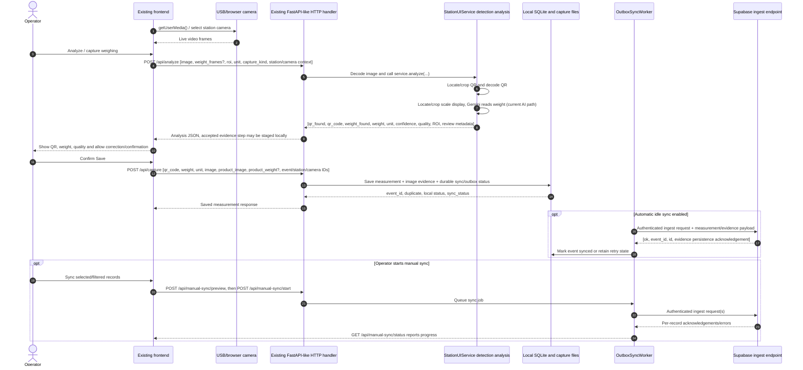
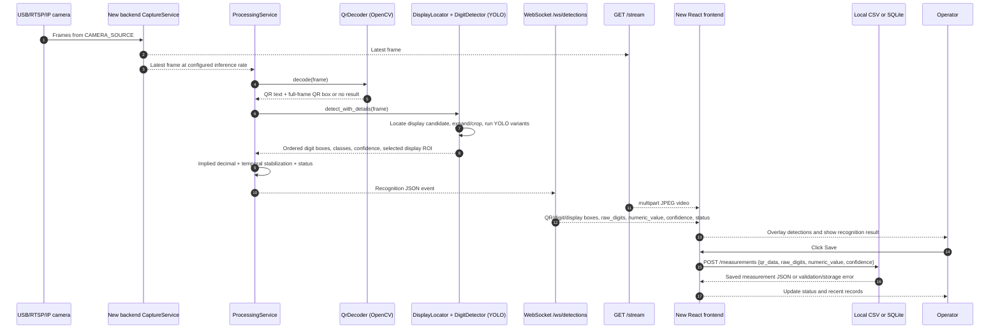
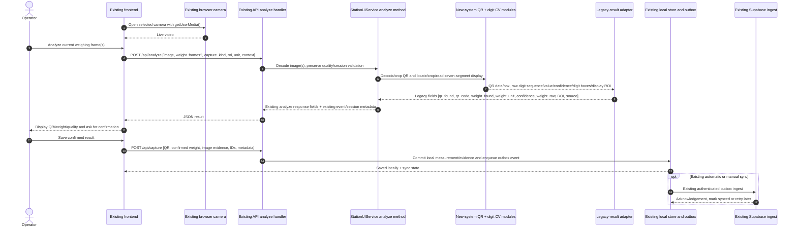

# Detection System Comparison and Local YOLO Migration

## Scope

This report compares the existing roll/QR station backend in `backend/src/roll_qr_scale` with the local detector in `new_system/Digit_QRCode_Detection`. The migration changes only QR/digit recognition and its display in the existing frontend. Camera acquisition, selected unit, capture/session flow, save/cache behavior, Supabase sync, and warehouse operations remain owned by the existing backend.

## Summary

The new system is the local CV engine for recognizing a red seven-segment display and decoding a QR code from a camera frame. Its QR and digit modules replace the corresponding recognition steps in the existing analysis path. The integration translates detector output into the legacy analyze response, since the current frontend and warehouse workflow consume that established response format.

The legacy system treats recognition as part of a larger warehouse operation: it accepts one or more images, supports core/product/inventory capture types, resolves provider and key choices, validates quality and weights, handles QR conflicts, produces audit metadata, and then feeds saving, review, and synchronization. Gemini can return a weight, unit, readability/agreement state, optional QR text, and display-blank state. The new system instead emits frame-level detections, an implied-decimal numeric value, and a QR result, then stabilizes those results for a live UI.

Implementation direction: the existing runtime is local-only. `/api/analyze` calls the new OpenCV QR crop/decoder and the new YOLO display locator/crop/digit detector. Gemini, Codex, Antigravity, PaddleOCR, and the separate Gemini Panel feature are not used as recognition fallbacks. The legacy response shape (`qr_found`, `qr_code`, `weight_found`, `weight`, `unit`, `confidence`, etc.) is retained for the old UI and save flow.

## Implemented decisions

- The active model is `new_system/Digit_QRCode_Detection/backend/model/best.pt` (model_2 mapping: `0='-'`, `1='.'`, `2..11='0'..'9'`). The old UI's selected unit is passed through unchanged; the detector applies the configured implied-decimal count, defaulting to two places (`040` → `0.40`).
- `ROLL_SCALE_DIGIT_MODEL`, `ROLL_SCALE_DIGIT_CONFIDENCE` (default `0.25`), `ROLL_SCALE_DIGIT_INFERENCE_CONFIDENCE` (default `0.70`), `ROLL_SCALE_DIGIT_IMAGE_SIZE` (default `640`), and `ROLL_SCALE_DECIMAL_PLACES` (default `2`) configure the local path.
- Empty/missed core detections remain unreadable for manual confirmation; they are not turned into zero by the local recognition result. A user-confirmed zero remains a valid explicit reading.
- Panel mode is disabled because the checkpoint is a seven-segment digit detector and cannot replace Gemini's arbitrary-region text recognition.
- The existing `/api/capture`, measurement store, photo drafts, cache, and Supabase outbox/sync code are not changed by this migration.
- The checkpoint is currently covered by the repository's `*.pt` ignore rule, and `new_system/` is untracked in this workspace. A Git clone or hosted build will not automatically receive this checkpoint; provide it at `ROLL_SCALE_DIGIT_MODEL` before starting the service.
- The backend imports the new CV modules in-process; it does not launch the new FastAPI app, camera service, React UI, or WebSocket server.

## System comparison

| Concern                 | Existing roll/QR backend                                                                                                                                                                                                    | `new_system/Digit_QRCode_Detection`                                                                                                                                                                     |
| ----------------------- | --------------------------------------------------------------------------------------------------------------------------------------------------------------------------------------------------------------------------- | ------------------------------------------------------------------------------------------------------------------------------------------------------------------------------------------------------- |
| Main role               | Multi-station factory/warehouse workflow, including core/product weights, QR, drafts, review, persistence, and remote sync                                                                                                  | Local live camera station for QR + seven-segment digit recognition and local CSV/SQLite persistence                                                                                                     |
| Recognition entry point | `StationUIService.analyze()` in `backend/src/roll_qr_scale/test_ui.py`; processing is serialized by `InferenceCoordinator`                                                                                                  | `ProcessingService._process()` in `new_system/Digit_QRCode_Detection/backend/src/backend/services/processing_service.py`                                                                                |
| Scale recognition       | `GeminiWeightReader.read()` returns `GeminiWeightSuggestion` from one or more supplied images; optional Codex/Antigravity providers and local PaddleOCR paths are also wired in                                             | `DigitDetector.detect_with_details()` local YOLO inference over red-display candidates; class mappings support model_1 and model_2, including sign/dot classes in model_2                               |
| Display localization    | Legacy scale ROI detection, configured/manual ROI, and Gemini-focused crop/evidence helpers in `test_ui.py`; Gemini can retry with a full-frame request                                                                     | HSV/color-based display candidate localization in `backend/src/backend/cv/display_locator.py`, then multiple crop scales/preprocessing passes in `digit_detector.py`                                    |
| QR recognition          | Dedicated `QRReader` in `backend/src/roll_qr_scale/qr_reader.py`, with optional custom YOLO QR localization. Gemini can also return QR content and code conflict handling combines the results                              | OpenCV `QRCodeDetector` crop/cache/tile pipeline in `backend/src/backend/cv/qr_decoder.py`; independent of the digit model                                                                              |
| Output contract         | Legacy analyze result has `weight_found`, numeric `weight`, `unit`, `confidence`, `weight_raw`, `recognition_source`, quality/review fields, QR fields, provider/token/fallback metadata, ROI metadata, and capture context | Detection event has `qr`, `raw_digits`, `numeric_value`, confidence, full-frame boxes, status, model version, and storage state                                                                         |
| Decimal/unit semantics  | Reads scale text including its displayed decimal and unit; validates parsed values and production limits downstream                                                                                                         | `build_recognition()` in `recognition/processor.py` applies the configured implied decimal places to detected digit sequence; it does not infer units and the frontend displays a fixed two-place value |
| Frame semantics         | Can accept burst frames and impose temporal agreement / require a minimum number of images for selected paths                                                                                                               | Processes the newest camera frame at a configured inference rate and stabilizes the QR+digit pair over successive frames                                                                                |
| Camera/UI               | Existing station-specific capture/session workflow and legacy UI/API                                                                                                                                                        | `CaptureService`, MJPEG `/stream`, WebSocket `/ws/detections`, and a React live overlay/save UI                                                                                                         |
| Persistence             | Existing measurement store, photo drafts, event identity, and optional sync/outbox are part of the workflow                                                                                                                 | Local repository interfaces (CSV/SQLite), recent-record API, and save-current-result flow                                                                                                               |

### Detection path details

**Existing Gemini path**

1. `StationUIService.analyze()` validates frame/burst inputs and capture context, resolves the station ROI, and selects the `weight_engine`/recognition provider.
2. `_analyze_frame()` decodes QR with the dedicated local QR reader, handles browser QR conflicts, checks image quality, and prepares scale ROI/crops.
3. For `weight_engine == "gemini"`, it chooses Gemini, Codex, or Antigravity, optionally crops to the scale head, reads the image(s), applies retries/fallback keys, reconciles AI/local QR results, and turns the result into a legacy `WeightReading`.
4. The resulting dictionary is consumed by existing capture, review, validation, persistence, and synchronization logic.

The engine choice and construction live in `backend/src/roll_qr_scale/test_ui.py`; Render defaults are passed through `backend/src/roll_qr_scale/render_app.py`. Gemini-specific reading/schema/blank-display and QR support live in `gemini_weight.py`. Key lifecycle and rotation are in `gemini_key_manager.py`. There are also Codex and Antigravity paths, so “Gemini engine” is not the only current recognition mode.

**New local path**

1. `ProcessingService` receives the latest camera frame at `INFERENCE_FPS`.
2. `QrDecoder.decode()` independently attempts cached/localized/cropped/tiled OpenCV QR decoding and returns QR text plus a full-frame box.
3. `DigitDetector.detect_with_details()` locates display candidates, evaluates crops/preprocessing variants using the local YOLO model, filters/orders detections, and returns digit boxes and selection diagnostics.
4. `build_recognition()` joins QR and digit results, applies the implied decimal rule, checks confidence, and uses a temporal stabilizer to decide `WAITING`, `INCOMPLETE`, `DETECTING`, `LOW_CONFIDENCE`, or `READY_TO_SAVE`.
5. The service publishes the event over WebSocket and MJPEG/REST APIs; the frontend overlays boxes and offers a local save action.

## Migration impact and compatibility gaps

1. **Value interpretation is different.** The new pipeline interprets digit glyphs using the configured decimal-place rule. For example, `643` becomes `6.43`; it does not return an independently recognized decimal mark or a unit. The legacy weight contract includes a unit and may accept different number formatting. The adapter must explicitly map configured scale precision and unit; it must not silently assume that every legacy scale uses the new system's two-decimal convention.
2. **Core/product is a workflow, not a single reading.** Existing capture types can represent a core scale and a product scale separately, then validate their relationship. The new system recognizes one configured display per camera frame. Each legacy station/camera and capture kind must be associated with the correct model/camera/configuration; the CV result must not be treated as both readings.
3. **Confidence meanings differ.** New-system confidence is derived from digit-box confidences (currently the minimum confidence of accepted ordered digits); Gemini readability and cross-frame agreement are different signals. Define an explicit acceptance policy and continue using legacy quality/production validation.
4. **Temporal policy differs.** The new system stabilizes repeated live frames, while legacy Gemini may read a burst and report whether all frames agree. A migration adapter must preserve the legacy requirement for enough independent captures where configured, or deliberately change and test that workflow.
5. **Blank core display semantics differ.** Gemini can identify an intentionally blank core display and legacy code can interpret that as zero for core capture. No equivalent “confirmed blank means zero” signal is exposed by the new detector. Do not map “no digit detections” to zero; it must remain unreadable/incomplete absent an explicit independently validated rule.
6. **QR policy differs.** The legacy path validates and reconciles a dedicated QR reader, browser-provided QR, Gemini QR, and conflicts. The new OpenCV QR result can replace or supplement one local decoder, but must preserve the legacy conflict/manual-review policy and product-code validation.
7. **Deployment assumptions differ.** The new backend expects local camera access, a local `.pt` checkpoint, OpenCV/Ultralytics/PyTorch dependencies, and its own settings/frontend. The legacy service is also used in hosted/Render workflows, where a directly attached USB camera and local model file may not exist. Local CV must be selectable and must fail clearly or be unavailable on deployments that cannot provide its model/camera.
8. **Diagnostics/audit fields differ.** Do not discard legacy event IDs, session binding, capture metadata, QR source, ROI, quality, review, or sync information when adapting the recognition result.

## Implemented integration

- The legacy backend loads `DigitDetector` and `QrDecoder` in-process from the new system's `backend/src/backend/cv` package. It does not start the new system's FastAPI server or frontend.
- Runtime always selects `local-yolo`, regardless of legacy Gemini/provider CLI settings. Remote recognition clients are not instantiated; their recognition/key endpoints and Panel endpoints return `410 ai_clients_disabled`.
- `POST /api/analyze`, `/api/decode`, and reread operations use the new QR crop/scan and display-crop/digit pipeline. QR decoder location caches are kept per station.
- The adapter returns the old response keys plus `display_bbox`, ordered `digit_detections`, `crop_scale`, `preprocessing`, and inference count. The old selected unit is retained. Only detections meeting the configured minimum inference confidence produce a numeric weight.
- The existing save/capture, photo draft, local storage, and Supabase outbox code was not changed. The UI displays local-YOLO/QR status, and local unreadable core readings remain blank for manual correction.
- The frontend continues to submit one image per read; local runtime sets the legacy burst count to one. Each capture kind (core/product) is still analyzed in its existing separate step.

## Remaining integration checks

- Install project dependencies (the root `pyproject.toml` includes Ultralytics) and run against representative real images/camera frames to validate accuracy and latency. In this workspace, `ultralytics` is not installed in the active system Python, so a real checkpoint inference was not possible during this implementation.
- The default checkpoint is in `new_system/Digit_QRCode_Detection/backend/model/best.pt`. It is currently ignored by `*.pt`, while `new_system/` is untracked. A Git clone/Render deployment will not contain the model unless the operator supplies it separately and sets `ROLL_SCALE_DIGIT_MODEL` to its path.
- Deployment still needs the model file and compatible PyTorch/Ultralytics runtime. The current Render requirements file does not package the checkpoint; do not deploy this local-only recognition path to a host until both are provided.

## Suggested acceptance criteria

- Correct QR and complete ordered digit sequence on the agreed validation set; no partial display accepted as a full reading.
- Correct decimal conversion and units for every configured station/capture kind.
- No unreadable/empty detection is silently interpreted as zero.
- QR conflicts remain visible and require the existing review/manual-resolution behavior.
- Existing core/product validation, event/session identity, save, draft, and sync behavior remains covered by regression tests.
- Local model/camera absence produces a clear unavailable/error state and does not prevent other configured recognition providers from operating.
- Measured p50/p95 inference latency meets an agreed target on the actual factory hardware.

## Files inspected

Existing application: `backend/src/roll_qr_scale/test_ui.py`, `gemini_weight.py`, `gemini_key_manager.py`, `qr_reader.py`, `inference_queue.py`, `scale.py`, and `render_app.py`.

New local application: `new_system/Digit_QRCode_Detection/backend/src/backend/main.py`, `config.py`, `services/processing_service.py`, `cv/digit_detector.py`, `cv/display_locator.py`, `cv/qr_decoder.py`, `cv/types.py`, `recognition/processor.py`, API/WebSocket routes, frontend recognition/overlay components, and backend/model-training tests. Both backend and model-training `best.pt` files are present in the new system; this report does not execute or benchmark them.

## End-to-end flow diagrams

### Existing roll/QR backend (before this integration)

The camera is opened by the browser using `getUserMedia()`. The browser captures one or more JPEG data URLs and sends them to the backend. The backend analyzes the image, then the operator confirms the result. A confirmed record is stored locally with image evidence and an outbox state. The outbox worker can sync in the background, or the operator can start a manual sync.

The diagram's “cache” is not a browser-only cache. `/api/analyze` can stage accepted capture evidence for a station workflow, and `/api/photo-capture` can save a photo draft. The final `/api/capture` writes the measurement and its evidence into the local store; if sync is configured, it is queued for the outbox. Supabase sync is a later step, either automatic or manually started.

### New local QR + digit system (actual current flow)

The new system has no Supabase upload route or sync worker in this backend. Its save endpoint persists to the configured local CSV/SQLite repository. Its camera feed is opened by the backend, unlike the existing browser-camera flow.

### Intended integration in the existing backend

This is the flow for replacing only the recognition logic while keeping the existing application workflow. The new QR decoder and digit/display detector are called synchronously from the existing analysis service after decoding the posted frame. Their outputs are adapted to the existing JSON result. The existing operator confirmation and persistence/sync steps then continue unchanged.

This does not require moving the new system's `main.py`, WebSocket server, or React app into the legacy application. The reusable part is its CV implementation: QR crop/decoder, display locator/crop generation, digit model and result mapping. The legacy application continues to own camera capture, HTTP API, frontend overlay/results, operator confirmation, local store, and Supabase sync.

## Important endpoints, inputs, and outputs

### Existing backend endpoints used by the weighing flow after integration

| Endpoint                        | Input                                                                                                                                                                                                                                                                                                     | Output / effect                                                                                                                                                                                                                                                                                                                                                                                      |
| ------------------------------- | --------------------------------------------------------------------------------------------------------------------------------------------------------------------------------------------------------------------------------------------------------------------------------------------------------- | ---------------------------------------------------------------------------------------------------------------------------------------------------------------------------------------------------------------------------------------------------------------------------------------------------------------------------------------------------------------------------------------------------- |
| `GET /api/status`               | No body                                                                                                                                                                                                                                                                                                   | Backend readiness and station identity; includes `pending_count`, `yolo_enabled`, `sync_enabled`, sync mode, quality settings and related status.                                                                                                                                                                                                                                                    |
| `POST /api/analyze`             | JSON with `image` as a base64/data URL; optionally `weight_frames: string[]` (ignored by local YOLO), `roi` (the new locator handles the crop), `unit`, `capture_kind`, `capture_round`, `client_qr_code`, event/station/camera IDs, `shift`, and `photo_capture_id`. Legacy `recognition_profile` / `recognition_provider` fields are accepted for compatibility but ignored. | JSON including the legacy `qr_found`, `qr_code`, `qr_decoder`, `qr_roi`, `weight_found`, `weight`, `unit`, `confidence`, `weight_raw`, `recognition_source="local-yolo"`, `roi`/`roi_method`, quality fields, plus `display_bbox`, `digit_detections`, `crop_scale`, `preprocessing`, and inference count. Accepted capture steps retain the old session binding/evidence staging behavior. |
| `POST /api/photo-capture`       | JSON with `image`, optional `client_qr_code`, event/parent event IDs, `capture_kind` (`core`, `product`, `inventory`), round, station/camera IDs and production context.                                                                                                                                  | `201` draft/capture metadata including local draft ID, QR result, duplicate state and sync status; this is a local photo draft, not the final measurement.                                                                                                                                                                                                                                           |
| `POST /api/capture`             | JSON with `qr_code`, confirmed `weight`, `unit`, `image`, required `product_image` for a production weighing, optional `product_weight`, `weight_raw`, `vision_confirmed`, and event/analysis/station/camera/machine/frame hash fields when bound.                                                        | `201` saved record including event ID, QR, weight/unit, duplicate and sync status; local measurement/evidence persisted and queued for sync when configured.                                                                                                                                                                                                                                         |
| `GET /api/measurements?...`     | Query filters/pagination such as `local_only`, `include_drafts`, `limit`, `offset`, date, shift, machine, production order, QR.                                                                                                                                                                           | Local/remote measurement and optionally draft rows, source/count metadata and pagination.                                                                                                                                                                                                                                                                                                            |
| `POST /api/manual-sync/preview` | JSON filters/selected event IDs.                                                                                                                                                                                                                                                                          | Counts and a preview of records eligible for Supabase sync; no upload yet.                                                                                                                                                                                                                                                                                                                           |
| `POST /api/manual-sync/start`   | Same selection/filter intent as preview.                                                                                                                                                                                                                                                                  | Starts/queues the manual sync job and returns queue/status information.                                                                                                                                                                                                                                                                                                                              |
| `GET /api/manual-sync/status`   | No body.                                                                                                                                                                                                                                                                                                  | Current sync progress, counts and error state.                                                                                                                                                                                                                                                                                                                                                       |
| `POST /api/decode`              | JSON `{ "image": "<data URL/base64>" }`.                                                                                                                                                                                                                                                                  | QR-only decode response with `found`, `qr_code`, decoder name, QR ROI/diagnostics.                                                                                                                                                                                                                                                                                                                   |

The existing UI uses `POST /api/analyze` to show recognition and `POST /api/capture` after the operator confirms it. Photo drafts are saved through `POST /api/photo-capture` in station workflows. The local persistence/outbox details are in `storage.py` and `sync.py`.

### New-system endpoints

| Endpoint                     | Input                                                                                            | Output / effect                                                                                                                                                                                        |
| ---------------------------- | ------------------------------------------------------------------------------------------------ | ------------------------------------------------------------------------------------------------------------------------------------------------------------------------------------------------------ |
| `GET /health`                | No body.                                                                                         | JSON readiness of camera/model/storage; `503` with component detail when a required service is unavailable.                                                                                            |
| `GET /stream`                | No body; browser keeps the HTTP connection open.                                                 | MJPEG multipart stream of the backend-captured camera frames.                                                                                                                                          |
| `WS /ws/detections`          | WebSocket connection; checks request `Origin` against configured CORS origins.                   | Repeated recognition JSON events; includes `qr`, `raw_digits`, `numeric_value`, `confidence`, `status`, `storage_enabled`, frame size and full-frame QR/digit/display boxes.                           |
| `GET /measurements?limit=20` | Optional `limit` from 1 to 100.                                                                  | Recent local records. With storage disabled, returns an empty list; unavailable configured storage returns an error.                                                                                   |
| `POST /measurements`         | JSON `{ "qr_data": string, "raw_digits": digits, "numeric_value": number, "confidence": 0..1 }`. | `201` saved measurement with ID/timestamps; rejects disabled/unavailable storage, stale/non-ready snapshot, mismatched recognition values or recent duplicates. Publishes a `SAVED` recognition event. |

There is no request that uploads a live video to the new backend's detector endpoint: the backend opens `CAMERA_SOURCE`, reads frames locally, and publishes the live video and detections separately. The React frontend displays `GET /stream` alongside the WebSocket events.

### Supabase handoff in the existing backend

Supabase ingestion is an outbound backend-to-backend request made by `OutboxSyncWorker`, not a frontend call to a Supabase endpoint. The worker sends a durable local record through the configured ingest URL with `X-Device-Token`; for image-enabled sync the payload includes base64 evidence images and event/workflow metadata. The response must confirm success and match the sent `event_id` and remote record ID; image persistence is also checked (or the endpoint must explicitly confirm durable local backup). On success, the local row becomes synced; failures remain retryable. Manual sync endpoints start or report this process.

## Narrow-scope implementation plan

1. **Keep the existing input/output API.** The legacy frontend continues opening the camera and posting captured frames to `/api/analyze`. `/api/analyze` returns the same legacy fields so the UI can continue rendering its current result and confirmation flow.
2. **Swap only the analysis internals.** In the backend analysis service, call the new local QR crop/decode path and the new display locator + digit crop + YOLO path. Keep image decode, station/session validation, quality checks, and the public API handler outside the CV modules.
3. **Add a result adapter.** Convert QR and digit detections into the fields the legacy application already needs: `qr_found`, `qr_code`, `qr_decoder`, `qr_roi`, `weight_found`, `weight`, `unit`, `confidence`, `weight_raw`, `recognition_source`, `roi`, and diagnostic boxes/metadata where useful. Continue mapping normalized or full-frame coordinates correctly so the frontend overlays align with the original frame.
4. **Keep weight semantics explicit.** Apply the configured scale's decimal places and unit during conversion. The new system's implicit decimal behavior is not automatically correct for every legacy scale. Do not treat no detections as zero; preserve unreadable/review behavior. Preserve the existing core/product relationship checks and production limits.
5. **Keep QR conflict rules.** Maintain validation between backend QR, optional browser-supplied QR, and any currently trusted decoder. Return conflicts for operator review; do not silently replace a conflicting QR value.
6. **Keep cache/save/sync flow.** Continue saving accepted evidence/drafts locally, then final confirmed measurements through `/api/capture`. Leave the local outbox, auto sync, manual sync endpoints and Supabase request contract intact.
7. **Port only the CV dependencies and lifecycle.** Initialize the YOLO model once at service startup, reuse it across analysis calls, and run inference through the existing single-worker `InferenceCoordinator`. Port the required QR OpenCV crop/decoder, display locator, and digit crop/detector modules rather than starting the new system's separate FastAPI app.
8. **Validate at the existing integration seam.** Compare old and new recognizers on the same saved frames. Confirm the `/api/analyze` response remains compatible, then verify one operator-confirmed `/api/capture` reaches local storage and Supabase sync with the same event and evidence. This report does not run those tests.

In short, the intended code boundary is the detection portion called by `StationUIService._analyze_frame()` (plus its ROI/crop helpers where the local CV replaces Gemini's scale-head crop/read). Endpoint and save/sync changes are not required by this plan.
